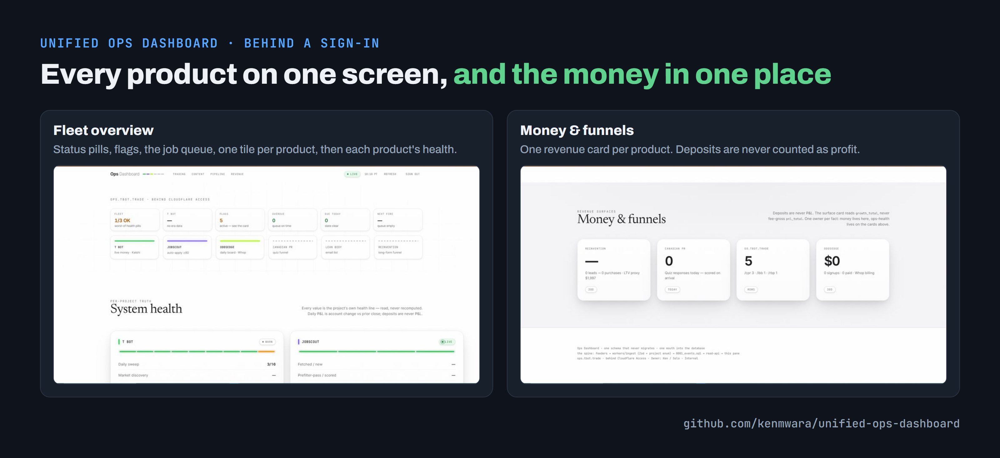

<!-- banner --><a href="https://github.com/kenmwara"></a>

# Unified Ops Dashboard

> One dashboard for every product: sales, sign-ups, replies and errors from each app land in one place, so it's easy to see what's working each week.

🌐 **Live:** ops.tbot.trade *(behind Cloudflare Access — operator only; see screenshots below)*
🏗️ **Stack:** Cloudflare D1 + Workers + Pages + Email Routing + Email Sending
🔒 **Source:** private — this README + screenshots are the showcase

---


## At a glance


<sub>Editable diagram: [images/event-flow.drawio](images/event-flow.drawio) (opens in diagrams.net).</sub>

## Screenshots



## What this is

Every product generates different event types — Stripe charges, support emails, T BOT trade fills, YouTube views, lead form submissions, market settlements. Before consolidation, each product was monitored in its own console, with no single view of which product was performing in a given week.

The Unified Ops Dashboard is a single web app that ingests events from every product, stores them in one D1 table, and renders unified rollups: 7-day revenue, leads, email opens, T BOT P&L, per-funnel conversion. One screen, full picture.

## Architecture


## Key design decisions

### 1. One event table, designed to never migrate

```sql
CREATE TABLE events (
  id          INTEGER PRIMARY KEY AUTOINCREMENT,
  project     TEXT NOT NULL,    -- 'tbot' | 'cpr' | 'lbb' | 'rbp' | 'maasai'
  event_type  TEXT NOT NULL,    -- 'daily_rollup' | 'lead' | 'purchase' | 'open' | ...
  title       TEXT NOT NULL,
  amount      REAL,
  currency    TEXT,
  source_id   TEXT,             -- product-side ID for dedup
  metadata    TEXT,             -- JSON blob — schema-less by design
  created_at  TEXT DEFAULT (datetime('now'))
);
CREATE UNIQUE INDEX idx_dedup ON events(project, source_id);
```

Schema is intentionally minimal. Every product writes through the same shape. The `metadata` JSON blob absorbs all per-product variation without requiring schema changes. **Every product. One schema. Zero migrations in production.**

### 2. Per-project ingest secrets, signed webhooks, separate write/read workers

Each product holds a per-project secret. POST `/ingest` rejects requests without matching `x-project-secret`. Stripe webhooks must also carry a valid HMAC signature inside a 5-minute window. Writing events goes through the ingest worker only; the read API serves the dashboard behind Cloudflare Access, so a failure on one side doesn't take down the other.

### 3. Append-only by design

Events are never updated, never deleted. Corrections are new events. Total source-of-truth for "what happened" across all products. The dashboard derives every visualization from rollups over this table.

### 4. Cloudflare-native end to end


<details><summary>The services as a table</summary>

| Concern | Cloudflare service |
|---|---|
| Domain + DNS | `tbot.trade` zone |
| Edge routing | Workers (ingest, read-api) |
| Database | D1 (SQLite at the edge) |
| Static site | Pages (the dashboard itself) |
| Webhooks in | Email Routing → ingest worker (support email) |
| Auth | Cloudflare Access |

</details>

**One vendor. One CLI (`wrangler`). One bill. Operational simplicity at multi-product scale beats best-of-breed sprawl for a small team.**

## What you see on the dashboard

- **Headline cards:** 7-day revenue · 7-day leads · 7-day email opens · T BOT 7-day P&L
- **Per-project rollups:** CPR conversion funnel (leads → opened → clicked → purchased), RBP audience growth, T BOT win-rate trend, LBB sales velocity
- **Event stream:** chronological log of every event across all products, filterable by project and type
- **Project filters:** ALL · TBOT · CPR · LBB · RBP — instant pivot

## Tech stack details

- **Workers:** TypeScript, with every incoming event checked against a fixed format (Zod)
- **D1:** Single migration (`0001_events.sql`), never altered in production
- **Pages:** vanilla HTML/CSS/JS (no framework — render is fast and the markup is auditable)
- **Email webhook bridges:** Cloudflare Email Routing → custom address → Worker that turns each support email into an event and forwards it to Gmail
- **Local dev:** `wrangler dev` for both workers; `pnpm db:migrate:local` mirrors prod schema; dev secrets in `.dev.vars`

## What was hard

- **Event-shape ambiguity across products.** "What counts as a lead?" was different per product. Solved by keeping the `event_type` enum small (~6 values) and pushing all per-product specifics into the `metadata` JSON.
- **Deduplication of webhook deliveries.** Stripe and the internal products both retry. Solved with the `(project, source_id)` unique index — duplicate POSTs are silent no-ops.
- **One database, many consumers.** Solved by splitting write (ingest) and read (read-api) into separate workers with different D1 bindings. The read-api can be rate-limited or cached aggressively without affecting ingestion.

## Security operations on the same event store

The same table, which can't be edited, is also T BOT's security log (SIEM). Intrusion detection on the trading server, audit trails from both APIs, and the exchange-side reconciliation that catches a misused API key all write security events into it, and a separate SOAR page on the dashboard turns them into a verdict, a timeline and six response playbooks. The full write-up, with screenshots: **[kenmwara/tbot-security](https://github.com/kenmwara/tbot-security)**.

<a href="https://github.com/kenmwara/tbot-security"></a>

## Planned enhancements

1. **Revenue alerting** — a summary when revenue drops sharply from one week to the next (security alerting already pages on Telegram)
2. **Per-product P&L view** with attribution (which ad campaign drove which lead drove which purchase)
3. **OpenTelemetry-style trace IDs** across products → dashboard, so a `lead → email_open → clicked → purchased` chain is visible as a single timeline

## Design rationale

Most operations dashboards are attached to a single product. This platform ingests from every product into *one D1
table* instead of running per-product analytics stacks, so onboarding a new product requires one HTTP call rather than
new infrastructure. Writing and reading run as two small Cloudflare Workers.

---

*Source code is private. The architecture, schema, and operational reasoning above are the showcase. Design discussions: [LinkedIn](https://linkedin.com/in/kenmwara).*
